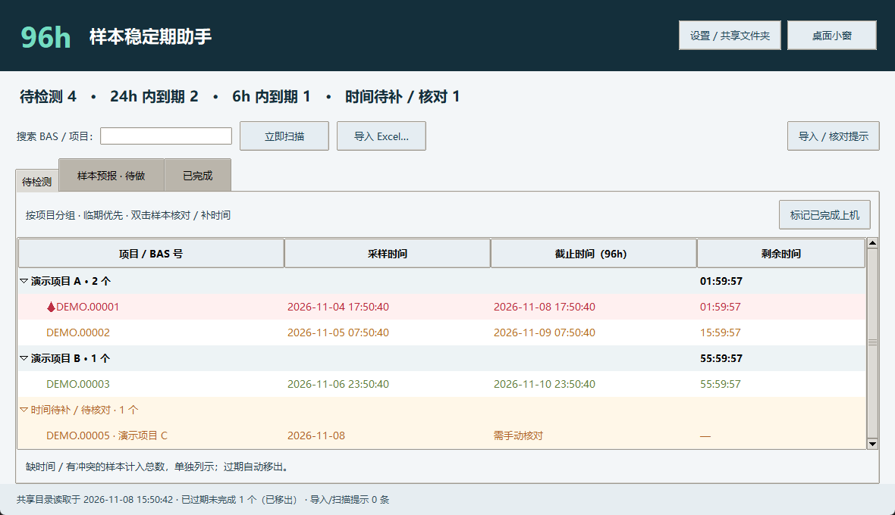
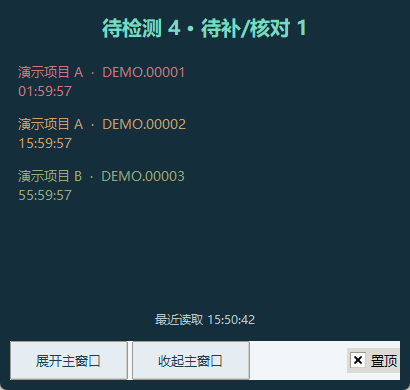

# 96h 样本稳定期助手 · 0.1.1

双击 **启动稳定期助手.bat**。首次填写姓名/工号，手动选择大家使用的同一个网络共享文件夹。每台电脑需要 Python 3.10+（含 tkinter）及 openpyxl；缺少依赖时运行 `py -m pip install -r requirements.txt`。本机已确认 Python 3.14、Tk 9、openpyxl 3.1.5 可用。

## 使用

- 把系统导出的 .xlsx / .xlsm 放在共享文件夹根目录或“待导入”子文件夹。也可点击“导入 Excel”，复制到共享待导入目录。旧式 .xls 须先另存为 xlsx。
- 每 10 秒扫描，每秒更新倒计时。刚修改的文件等待至少 3 秒再读取。Excel 原件不移动、不删除。
- 按样品编号/BAS ID 去重，BAS课题号/课题号分组。前 30 行优先匹配表头。对于保留原文件名的 Quick Check Sample Items 导出，表头匹配失败时按 Y 列读取样品编号、AN 列读取项目号。
- 优先采用 Collection Date and Time；缺失时组合 Collection Date + Collection Time。缺时分不补零点，两份时间不一致或重复 BAS 内容冲突时放入“时间待补/待核对”，双击人工确认。
- 日期时间按工作电脑当地时间，电脑应设为中国时区并校准时钟。固定采样后 96h。首页总数包含时间待补/待核对，不含已过期和已完成。
- 按项目折叠，临期优先。颜色在 24/12/6h 依次经过黄/橙/红，最后 6h 淡红底和小血滴图标。
- Ctrl/Shift 多选样本，标记“已完成上机”；在“已完成”撤销。重复导入不会重置完成。过期自动移出首页；撤销时如果已过期也不回首页。底部提示过期未完成数。
- 桌面小窗可置顶，显示最近四个样本，可收起和展开主窗口。此版在主窗口完成操作，尚无托盘、开机启动、系统通知。
- 样本预报只有“待做”占位页，不生成预报。

## 多人共享及断网

软件在共享目录下创建 `_稳定期助手/操作记录`，每条导入、完成、撤销和人工修正单独存储。勿手动编辑。写入用目录锁串行处理，以同目录临时文件和原子替换发布。本地缓存、姓名和路径在 `%LOCALAPPDATA%/SampleStability96`，不同共享路径分开缓存。

相同 Excel 内容按 SHA256 只导入一次，重复 BAS 只补缺失资料，有冲突先核对。人工确认的项目和采样时间优先。操作记录包含姓名、电脑名和时间；姓名是标记，不是身份认证。多人基于旧状态提交时拒绝过期操作，要求刷新。批量逐条提交，中途失败可能部分完成，需要刷新核对。

断网保留缓存和倒计时，不允许离线提交。共享读取成功不代表已检查所有同事电脑。电脑休眠/关机不扫描、不提醒，恢复后按当前时间重算。

每个人需有列目录、读取、写入、创建文件夹、重命名和删除软件临时文件的权限。异常退出可能遗留“写入锁”空目录：仅在管理员确认所有客户端停止写入后移除；软件不会自动抢锁。真实共享盘的锁和重命名行为必须实测。

建议专用共享目录。扫描范围只含根目录和“待导入”，可手动把旧 Excel 移到其他归档子目录，软件事件仍保留数据。此版全量回放事件，规模增长后需要优化。

## 验证限制

导入映射基于四张照片，尚未获得真实 Excel 工作簿。测试用人工构造的文件，不等同于单位原始 Excel、真实网络盘或两台实机验收。正式使用前请拿脱敏原始导出表核对，并在两台电脑验证导入、去重、补时间、完成、撤销、断网恢复。

检查命令：`py -m unittest discover -s tests -v`。
