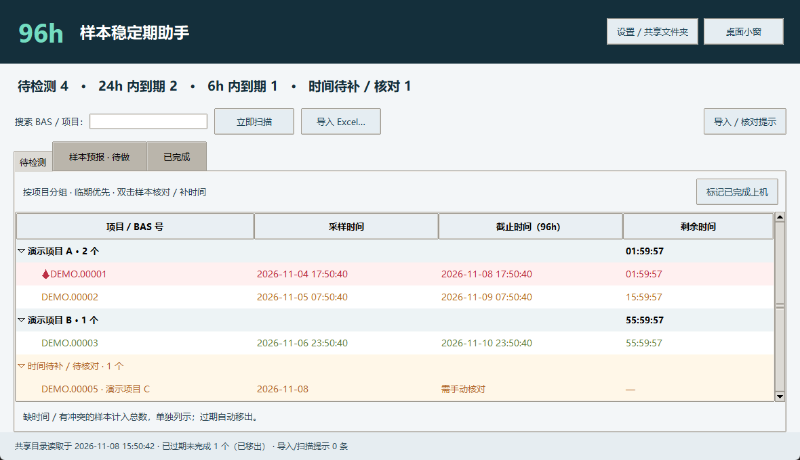
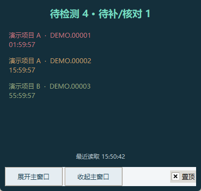

# Sample Stability 96h · v0.1.1

A Windows desktop tool for tracking the 96-hour stability window of laboratory samples, with shared-folder collaboration.

Double-click **启动稳定期助手.bat**. On first launch, enter your name or staff ID and select the same network shared folder used by your colleagues. Each computer needs Python 3.10+ with tkinter and openpyxl. Install missing dependencies with `py -m pip install -r requirements.txt`. Python 3.14, Tk 9, and openpyxl 3.1.5 were confirmed on the development computer.

The software interface remains in Chinese. Chinese labels and paths below identify the existing controls and folders.





## Usage

- Place system-exported .xlsx or .xlsm files in the shared folder root or its pending-import subfolder (`待导入`). Alternatively, click Import Excel (`导入 Excel`) to copy files there. Save legacy .xls files as .xlsx first.
- Files are scanned every 10 seconds, and countdowns update every second. Recently modified files wait at least 3 seconds before being read. Original Excel files are neither moved nor deleted.
- Samples are deduplicated by sample number / BAS ID and grouped by BAS study number / study number. Headers are matched within the first 30 rows. For Quick Check Sample Items exports retaining their original filenames, failed header matching falls back to column Y for sample number and column AN for project number.
- Collection Date and Time takes priority; otherwise, Collection Date and Collection Time are combined. Missing times are not assumed to be midnight. Conflicting timestamps or duplicate BAS details are placed in the time-review group (`时间待补/待核对`); double-click to confirm manually.
- Dates and times use the workstation's local time. Set the computer to the China time zone and keep its clock accurate. Stability expires 96 hours after collection. The home total includes samples awaiting time review and excludes expired and completed samples.
- Samples are grouped by project, with the nearest deadline first. Colours change to yellow, orange, and red at 24, 12, and 6 hours remaining. The final 6 hours also show a pale red background and a blood-drop icon.
- Use Ctrl/Shift to select multiple samples and mark acquisition complete (`已完成上机`). Undo from Completed (`已完成`). Reimporting does not reset completion. Expired samples leave the home view automatically; undoing completion does not return an expired sample to it. The footer shows the number of expired, unfinished samples.
- The desktop mini window can stay on top and display the next four samples. It can collapse or reopen the main window. Operations are performed in the main window; this version has no system tray, startup integration, or system notifications.
- Sample forecasting is a placeholder and does not generate forecasts.

## Shared use and network interruptions

The application creates `_稳定期助手/操作记录` in the shared folder. Each import, completion, undo, or manual correction is stored separately. Do not edit these records manually. A directory lock serialises writes; temporary files in the same directory and atomic replacement publish updates. Local caches, user names, and paths are stored in `%LOCALAPPDATA%/SampleStability96`, with separate caches for different shared paths.

Identical Excel content is imported once using SHA-256. Duplicate BAS entries only fill missing information; conflicts require review. Manually confirmed projects and collection times take priority. Operation records include the user name, computer name, and time. The name is a label, not authentication. Changes based on stale shared state are rejected and require a refresh. Batch operations commit one item at a time; a failure may leave a partially completed batch, so refresh and check.

During a network interruption, cached data and countdowns remain available, but offline changes cannot be submitted. A successful shared-folder read does not establish that every colleague's computer has been tested. Sleeping or powered-off computers do not scan or alert; countdowns are recalculated on resume.

Users need permission to list, read, write, create folders, rename, and delete the application's temporary files. An abnormal exit may leave an empty write-lock directory. Remove it only after an administrator confirms that all clients have stopped writing. The application does not take over locks automatically. Locking and renaming must be tested on the actual shared drive.

Use a dedicated shared folder. Scanning covers only the root and `待导入`; old Excel files can be moved manually to other archive subfolders without losing event data. This version replays all events and will need optimisation as the record count grows.

## Verification limits

Import mapping was based on four photographs; no original Excel workbook was available. Tests use synthetic files and do not establish acceptance of workplace exports, a real network drive, or two physical clients. Before operational use, check de-identified original exports and test import, deduplication, time correction, completion, undo, and recovery from a network interruption on two computers.

Run checks with:

```powershell
py -m unittest discover -s tests -v
```

## Browser version · v0.2.0

Double-click **Start-Web.bat** and keep the launcher window open. Dependencies are the same as the desktop version. Existing settings are loaded automatically. Shared Settings (`共享设置`) in the top-right corner also accepts the full path to the common shared folder. The web server listens only on the local computer; colleagues launch their own instance to use the same shared records.

The browser version supports Excel import, 10-second scanning, live 96-hour countdowns, review queues, completion, undo, and expired-sample lookup. Excel uploads are limited to 30 MB. Browser operations currently apply to individual samples; use the desktop version for batch selection and the always-on-top mini window. Forecasting is not implemented. Both versions use the existing event format. Test the company shared drive with de-identified Excel files and two computers before rollout.
